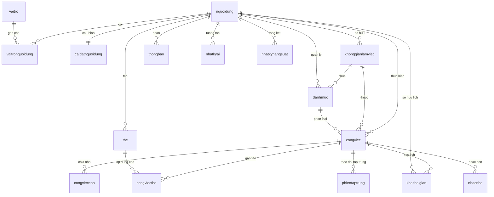

# TÀI LIỆU GIẢI THÍCH CHI TIẾT CƠ SỞ DỮ LIỆU (DATABASE SPECIFICATION)
## HỆ THỐNG QUẢN LÝ VÀ TỰ ĐỘNG LẬP LỊCH CÔNG VIỆC CÁ NHÂN (SMARTTASK AI)
**Hệ quản trị CSDL:** PostgreSQL 17  
**Database Name:** `quanlycongviec_db`  
**File kịch bản khởi tạo:** [`database/init_db_quanlycongviec.sql`](file:///d:/DACN_QUANLYCONGVIECCANHAN/database/init_db_quanlycongviec.sql)  
**Quy chuẩn đặt tên thống nhất:**
- **Tên bảng:** 100% chữ thường (lowercase), tuyệt đối không dùng dấu gạch dưới `_`.
- **Tên thuộc tính (cột):** Viết hoa các âm (PascalCase), tuyệt đối không dùng dấu gạch dưới `_` (ví dụ: `HoVaTen`, `NgayTao`, `HanChot`, `TieuDe`...).

---

## 1. TỔNG QUAN KIẾN TRÚC CƠ SỞ DỮ LIỆU

Hệ thống cơ sở dữ liệu được thiết kế chuẩn hóa (3NF), tối ưu hóa cho bài toán lập lịch tự động (Auto-scheduling), ma trận Eisenhower, hỗ trợ tích hợp Trí tuệ Nhân tạo Gemini AI và thông báo quyết định thông minh.

---

## 2. GIẢI THÍCH CHI TIẾT CÁC BẢNG VÀ TỪNG TRƯỜNG DỮ LIỆU

### 2.1. Bảng `nguoidung` (Quản lý Người dùng & Tài khoản)
Lưu trữ thông tin định danh người dùng trên toàn hệ thống.

| Tên trường (Column) | Kiểu dữ liệu | Ràng buộc | Giá trị mặc định | Giải thích ý nghĩa & Nghiệp vụ |
| :--- | :--- | :--- | :--- | :--- |
| `id` | `BIGSERIAL` | PRIMARY KEY | Tự tăng | Khóa chính định danh duy nhất người dùng. |
| `Email` | `VARCHAR(120)` | NOT NULL, UNIQUE | | Địa chỉ email đăng nhập, dùng để xác thực và nhận thông báo. |
| `MatKhau` | `VARCHAR(255)` | NOT NULL | | Mật khẩu đã được băm an toàn bằng thuật toán BCrypt. |
| `HoVaTen` | `VARCHAR(100)` | NOT NULL | | Họ tên hiển thị của người dùng (ví dụ: *"Minh Anh"* trên giao diện). |
| `SoDienThoai` | `VARCHAR(20)` | NULL | NULL | Số điện thoại liên hệ (phục vụ SMS nhắc nhở khẩn cấp nếu có). |
| `AnhDaiDien` | `VARCHAR(500)` | NULL | NULL | Đường dẫn ảnh đại diện. Nếu rỗng, giao diện hiển thị avatar chữ cái viết tắt (như *"MA"*). |
| `NguonXacThuc` | `VARCHAR(20)` | NOT NULL | `'LOCAL'` | Phương thức xác thực: `'LOCAL'` (Email/Password) hoặc `'GOOGLE'` (OAuth2). |
| `KichHoat` | `BOOLEAN` | NOT NULL | `TRUE` | Trạng thái kích hoạt tài khoản. `FALSE` khi tài khoản bị khóa. |
| `XacThucEmail` | `BOOLEAN` | NOT NULL | `FALSE` | Trạng thái xác thực email sau khi đăng ký. |
| `NgayTao` | `TIMESTAMPTZ` | NOT NULL | `CURRENT_TIMESTAMP` | Thời điểm đăng ký tài khoản. |
| `NgayCapNhat` | `TIMESTAMPTZ` | NOT NULL | `CURRENT_TIMESTAMP` | Thời điểm cập nhật thông tin cá nhân lần gần nhất. |

---

### 2.2. Bảng `vaitro` & `vaitronguoidung` (Phân quyền bảo mật RBAC)
Phục vụ cơ chế Spring Security phân quyền người dùng và quản trị viên.

#### Bảng `vaitro`:
| Tên trường | Kiểu dữ liệu | Ràng buộc | Ý nghĩa |
| :--- | :--- | :--- | :--- |
| `id` | `SERIAL` | PRIMARY KEY | Khóa chính vai trò. |
| `TenVaiTro` | `VARCHAR(50)` | NOT NULL, UNIQUE | Mã vai trò: `'ROLE_USER'` (Người dùng cá nhân), `'ROLE_ADMIN'` (Quản trị viên hệ thống). |
| `MoTa` | `VARCHAR(255)` | NULL | Mô tả chi tiết quyền hạn của vai trò. |

#### Bảng `vaitronguoidung`:
| Tên trường | Kiểu dữ liệu | Ràng buộc | Ý nghĩa |
| :--- | :--- | :--- | :--- |
| `NguoiDungId` | `BIGINT` | NOT NULL, FK(`nguoidung.id`) | Khóa ngoại tham chiếu đến người dùng. Tự xóa khi user bị xóa (`ON DELETE CASCADE`). |
| `VaiTroId` | `INT` | NOT NULL, FK(`vaitro.id`) | Khóa ngoại tham chiếu đến vai trò. |
*(Khóa chính kết hợp: `PRIMARY KEY ("NguoiDungId", "VaiTroId")`)*

---

### 2.3. Bảng `caidatnguoidung` (Cấu hình Thói quen cá nhân & Thuật toán AI)
Lưu trữ các tham số quan trọng để Động cơ Lập lịch Tự động (Auto-Scheduling Engine) biết khung giờ làm việc, giờ rảnh và thời gian đệm.

| Tên trường | Kiểu dữ liệu | Ràng buộc | Giá trị mặc định | Giải thích ý nghĩa & Nghiệp vụ |
| :--- | :--- | :--- | :--- | :--- |
| `id` | `BIGSERIAL` | PRIMARY KEY | Tự tăng | Khóa chính cấu hình. |
| `NguoiDungId` | `BIGINT` | NOT NULL, UNIQUE, FK | | Khóa ngoại 1-1 với `nguoidung.id`. Mỗi người dùng có 1 cấu hình. |
| `GioBatDauLamViec` | `TIME` | NOT NULL | `'08:00:00'` | Giờ bắt đầu một ngày làm việc (mặc định 08:00 sáng). |
| `GioKetThucLamViec` | `TIME` | NOT NULL | `'18:00:00'` | Giờ kết thúc ngày làm việc (mặc định 18:00 chiều). |
| `NgayLamViec` | `VARCHAR(50)` | NOT NULL | `'MON,TUE,WED,THU,FRI'` | Danh sách các ngày làm việc trong tuần. |
| `ThoiGianDemPhut` | `INT` | NOT NULL | `15` | Thời gian đệm (Buffer time) giữa 2 việc liên tiếp (15 phút). |
| `ThoiGianHieuSuatCao` | `VARCHAR(20)`| NOT NULL | `'MORNING'` | Khung giờ tập trung cao nhất: `'MORNING'`, `'AFTERNOON'`, `'EVENING'`. |
| `ThoiGianPomodoroMacDinh` | `INT` | NOT NULL | `25` | Thời lượng mặc định một phiên Pomodoro (25 phút). |
| `NghiNganMacDinh` | `INT` | NOT NULL | `5` | Thời gian nghỉ ngắn (5 phút). |
| `NghiDaiMacDinh` | `INT` | NOT NULL | `15` | Thời gian nghỉ dài sau 4 chu kỳ (15 phút). |
| `TuDongDoiLich` | `BOOLEAN` | NOT NULL | `TRUE` | Cho phép AI tự động dời lịch khi trễ việc. |
| `MuiGio` | `VARCHAR(50)` | NOT NULL | `'Asia/Ho_Chi_Minh'` | Múi giờ người dùng (GMT+7). |
| `GiaoDien` | `VARCHAR(20)` | NOT NULL | `'LIGHT'` | Giao diện: `'LIGHT'`, `'DARK'`, `'SYSTEM'`. |
| `NgayTao` / `NgayCapNhat` | `TIMESTAMPTZ` | NOT NULL | `CURRENT_TIMESTAMP` | Thời điểm tạo và cập nhật. |

---

### 2.4. Bảng `khonggianlamviec` (Không gian làm việc độc lập)
Quản lý các Workspace độc lập (Không gian cá nhân, Đồ án tốt nghiệp, Dự án công ty...), giúp tách biệt hoàn toàn công việc và danh mục.

| Tên trường | Kiểu dữ liệu | Ràng buộc | Giá trị mặc định | Giải thích ý nghĩa & Nghiệp vụ |
| :--- | :--- | :--- | :--- | :--- |
| `id` | `BIGSERIAL` | PRIMARY KEY | Tự tăng | Khóa chính không gian làm việc. |
| `NguoiDungId` | `BIGINT` | NOT NULL, FK | | Khóa ngoại người sở hữu không gian. |
| `TenKhongGian` | `VARCHAR(100)`| NOT NULL | | Tên không gian làm việc. |
| `TenBieuTuong` | `VARCHAR(50)` | NULL | `'Briefcase'` | Tên biểu tượng hiển thị (User, Briefcase, GraduationCap...). |
| `MacDinh` | `BOOLEAN` | NOT NULL | `FALSE` | Đánh dấu không gian mặc định ban đầu. |
| `NgayTao` / `NgayCapNhat` | `TIMESTAMPTZ` | NOT NULL | `CURRENT_TIMESTAMP` | Thời điểm tạo và cập nhật. |

---

### 2.5. Bảng `danhmuc` (Danh mục công việc)
Tương ứng với mục **"Nhóm của tôi"** trên Sidebar: *Học tập, Công việc, Sức khỏe, Giải trí*.

| Tên trường | Kiểu dữ liệu | Ràng buộc | Giá trị mặc định | Giải thích ý nghĩa & Nghiệp vụ |
| :--- | :--- | :--- | :--- | :--- |
| `id` | `BIGSERIAL` | PRIMARY KEY | Tự tăng | Khóa chính danh mục. |
| `NguoiDungId` | `BIGINT` | NOT NULL, FK | | Khóa ngoại người sở hữu. |
| `KhongGianId` | `BIGINT` | NULL, FK | NULL | Không gian làm việc trực thuộc. |
| `TenDanhMuc` | `VARCHAR(100)`| NOT NULL | | Tên nhóm: *Học tập, Công việc, Sức khỏe, Giải trí*. |
| `MaMau` | `VARCHAR(20)` | NOT NULL | `'#4F46E5'` | Mã màu HEX đại diện (`#3B82F6`, `#8B5CF6`, `#10B981`...). |
| `TenBieuTuong` | `VARCHAR(50)` | NULL | `'Folder'` | Tên biểu tượng Lucide (`Folder`, `BookOpen`, `Heart`...). |
| `MacDinh` | `BOOLEAN` | NOT NULL | `FALSE` | Cờ đánh dấu danh mục mặc định. |
| `NgayTao` / `NgayCapNhat` | `TIMESTAMPTZ` | NOT NULL | `CURRENT_TIMESTAMP` | Thời điểm tạo và cập nhật. |

---

### 2.6. Bảng `the` & `congviecthe` (Thẻ phân loại nhãn)
Cho phép gắn nhiều nhãn linh hoạt vào công việc (ví dụ: `#DoAn`, `#Meeting`, `#DeepWork`).

#### Bảng `the`:
| Tên trường | Kiểu dữ liệu | Ràng buộc | Ý nghĩa |
| :--- | :--- | :--- | :--- |
| `id` | `BIGSERIAL` | PRIMARY KEY | Khóa chính thẻ tag. |
| `NguoiDungId` | `BIGINT` | NOT NULL, FK | Người tạo thẻ. |
| `TenThe` | `VARCHAR(50)` | NOT NULL | Tên thẻ ngắn gọn. |
| `MaMau` | `VARCHAR(20)` | NOT NULL | Mã màu thẻ hiển thị. |
| `NgayTao` | `TIMESTAMPTZ` | NOT NULL | Thời điểm tạo. |

#### Bảng `congviecthe`:
| Tên trường | Kiểu dữ liệu | Ràng buộc | Ý nghĩa |
| :--- | :--- | :--- | :--- |
| `CongViecId` | `BIGINT` | NOT NULL, FK(`congviec.id`) | Khóa ngoại công việc. |
| `TheId` | `BIGINT` | NOT NULL, FK(`the.id`) | Khóa ngoại thẻ tag. |

---

### 2.7. Bảng `congviec` (Công việc / Nhiệm vụ cốt lõi)
Bảng trung tâm quản lý mọi đầu việc, liên kết ma trận Eisenhower, mức độ ưu tiên, hạn chót và trạng thái.

| Tên trường | Kiểu dữ liệu | Ràng buộc | Giá trị mặc định | Giải thích ý nghĩa & Nghiệp vụ |
| :--- | :--- | :--- | :--- | :--- |
| `id` | `BIGSERIAL` | PRIMARY KEY | Tự tăng | Khóa chính công việc. |
| `NguoiDungId` | `BIGINT` | NOT NULL, FK | | Khóa ngoại người sở hữu công việc. |
| `KhongGianId` | `BIGINT` | NOT NULL, FK | | Thuộc không gian làm việc nào. |
| `DanhMucId` | `BIGINT` | NULL, FK | NULL | Nhóm công việc trực thuộc. |
| `TieuDe` | `VARCHAR(255)`| NOT NULL | | Tên công việc (*"Làm báo cáo đồ án"*, *"Thiết kế giao diện"*). |
| `MoTa` | `TEXT` | NULL | NULL | Nội dung chi tiết, ghi chú đính kèm. |
| `MucDoUuTien` | `VARCHAR(20)` | NOT NULL | `'MEDIUM'` | Mức độ ưu tiên: `'LOW'`, `'MEDIUM'`, `'HIGH'`, `'URGENT'`. |
| `GocPhanTu` | `VARCHAR(20)` | NOT NULL | `'SCHEDULE'` | Ma trận Eisenhower: `'DO_FIRST'`, `'SCHEDULE'`, `'DELEGATE'`, `'DONT_DO'`. |
| `TrangThai` | `VARCHAR(20)` | NOT NULL | `'TODO'` | Trạng thái: `'TODO'`, `'IN_PROGRESS'`, `'COMPLETED'`, `'CANCELLED'`, `'OVERDUE'`. |
| `HanChot` | `TIMESTAMPTZ` | NULL | NULL | Deadline hoàn thành công việc. |
| `ThoiLuongUocTinh` | `INT` | NOT NULL | `30` | Thời lượng dự kiến cần hoàn thành (phút). |
| `ThoiLuongThucTe` | `INT` | NOT NULL | `0` | Thời gian thực tế đã làm (cộng dồn từ Pomodoro). |
| `LichCoDinh` | `BOOLEAN` | NOT NULL | `FALSE` | Cố định giờ: `TRUE` nếu là giờ học/họp cố định, AI không tự dời. |
| `BatDauCoDinh` | `TIMESTAMPTZ` | NULL | NULL | Thời gian bắt đầu nếu là việc cố định. |
| `KetThucCoDinh` | `TIMESTAMPTZ` | NULL | NULL | Thời gian kết thúc nếu là việc cố định. |
| `LapLai` | `BOOLEAN` | NOT NULL | `FALSE` | Đánh dấu công việc lặp lại định kỳ (hiển thị biểu tượng `↻`). |
| `QuyTacLapLai` | `VARCHAR(100)`| NULL | NULL | Chu kỳ lặp lại: `'DAILY'`, `'WEEKLY'`, `'MONTHLY'`. |
| `CongViecChaId` | `BIGINT` | NULL, FK | NULL | Cho công việc quan hệ phân cấp cha - con. |
| `HoanThanhLuc` | `TIMESTAMPTZ` | NULL | NULL | Thời điểm hoàn thành công việc. |
| `NgayTao` / `NgayCapNhat` | `TIMESTAMPTZ` | NOT NULL | `CURRENT_TIMESTAMP` | Thời điểm tạo và chỉnh sửa. |

---

### 2.8. Bảng `congvieccon` (Checklist / Công việc con)
Lưu danh sách các bước con cần thực hiện.

| Tên trường | Kiểu dữ liệu | Ràng buộc | Giá trị mặc định | Giải thích ý nghĩa & Nghiệp vụ |
| :--- | :--- | :--- | :--- | :--- |
| `id` | `BIGSERIAL` | PRIMARY KEY | Tự tăng | Khóa chính việc con. |
| `CongViecId` | `BIGINT` | NOT NULL, FK | | Khóa ngoại tham chiếu công việc cha (`ON DELETE CASCADE`). |
| `TieuDe` | `VARCHAR(255)`| NOT NULL | | Tên bước công việc con cần làm. |
| `HoanThanh` | `BOOLEAN` | NOT NULL | `FALSE` | Trạng thái hoàn thành bước con. |
| `ThoiLuongPhut` | `INT` | NOT NULL | `15` | Thời lượng dự kiến cho bước con. |
| `ThuTu` | `INT` | NOT NULL | `0` | Thứ tự hiển thị. |
| `NgayTao` | `TIMESTAMPTZ` | NOT NULL | `CURRENT_TIMESTAMP` | Thời điểm tạo. |

---

### 2.9. Bảng `khoithoigian` (Khối thời gian trên Lịch biểu - Time-blocking)
**Bảng trực tiếp ánh xạ ra Lưới lịch tuần (Weekly Calendar Grid 0:00 - 23:59 trên giao diện)!**  
Mỗi ô màu sự kiện trên lịch tương ứng với một bản ghi trong bảng này.

| Tên trường | Kiểu dữ liệu | Ràng buộc | Giá trị mặc định | Giải thích ý nghĩa & Nghiệp vụ |
| :--- | :--- | :--- | :--- | :--- |
| `id` | `BIGSERIAL` | PRIMARY KEY | Tự tăng | Khóa chính khối thời gian. |
| `NguoiDungId` | `BIGINT` | NOT NULL, FK | | Người sở hữu lịch biểu. |
| `CongViecId` | `BIGINT` | NULL, FK | NULL | Tham chiếu đến công việc được gán. |
| `TieuDe` | `VARCHAR(255)`| NOT NULL | | Tiêu đề khối thời gian hiển thị trên lịch. |
| `ThoiGianBatDau` | `TIMESTAMPTZ` | NOT NULL | | Thời gian bắt đầu khối lịch. |
| `ThoiGianKetThuc` | `TIMESTAMPTZ` | NOT NULL | | Thời gian kết thúc khối lịch. |
| `TuDongXepLich` | `BOOLEAN` | NOT NULL | `FALSE` | Cờ đánh dấu do **AI tự động xếp** vào khoảng trống hay tự đặt tay. |
| `TrangThai` | `VARCHAR(20)` | NOT NULL | `'SCHEDULED'` | Trạng thái: `'SCHEDULED'`, `'IN_PROGRESS'`, `'COMPLETED'`, `'CANCELLED'`. |
| `MaMau` | `VARCHAR(20)` | NULL | NULL | Mã màu ô sự kiện trên lịch. |
| `GhiChu` | `TEXT` | NULL | NULL | Ghi chú thêm cho phiên làm việc này. |
| `NgayTao` / `NgayCapNhat` | `TIMESTAMPTZ` | NOT NULL | `CURRENT_TIMESTAMP` | Thời điểm tạo và cập nhật khối lịch. |

---

### 2.10. Bảng `phientaptrung` (Phiên tập trung Pomodoro)
Ghi nhận lịch sử bật chế độ tập trung làm việc, đo lường tổng số giờ tập trung hiển thị trên thanh thống kê.

| Tên trường | Kiểu dữ liệu | Ràng buộc | Giá trị mặc định | Giải thích ý nghĩa & Nghiệp vụ |
| :--- | :--- | :--- | :--- | :--- |
| `id` | `BIGSERIAL` | PRIMARY KEY | Tự tăng | Khóa chính phiên tập trung. |
| `NguoiDungId` | `BIGINT` | NOT NULL, FK | | Người dùng thực hiện. |
| `CongViecId` | `BIGINT` | NULL, FK | NULL | Công việc thực hiện trong phiên này. |
| `ThoiGianBatDau` | `TIMESTAMPTZ` | NOT NULL | | Thời điểm bắt đầu. |
| `ThoiGianKetThuc` | `TIMESTAMPTZ` | NULL | NULL | Thời điểm kết thúc. |
| `ThoiLuongPhut` | `INT` | NOT NULL | `25` | Thời lượng phiên (phút). |
| `LoaiPhien` | `VARCHAR(20)` | NOT NULL | `'WORK'` | Loại phiên: `'WORK'`, `'SHORT_BREAK'`, `'LONG_BREAK'`. |
| `HoanThanh` | `BOOLEAN` | NOT NULL | `TRUE` | `TRUE` nếu hoàn thành trọn vẹn không hủy ngang. |
| `GhiChu` | `TEXT` | NULL | NULL | Ghi chú sau phiên. |
| `NgayTao` | `TIMESTAMPTZ` | NOT NULL | `CURRENT_TIMESTAMP` | Thời điểm tạo. |

---

### 2.11. Bảng `nhacnho` (Nhắc nhở)
Quản lý các thời điểm nhắc hẹn trước giờ bắt đầu công việc.

| Tên trường | Kiểu dữ liệu | Ràng buộc | Giá trị mặc định | Giải thích ý nghĩa & Nghiệp vụ |
| :--- | :--- | :--- | :--- | :--- |
| `id` | `BIGSERIAL` | PRIMARY KEY | Tự tăng | Khóa chính lời nhắc. |
| `NguoiDungId` | `BIGINT` | NOT NULL, FK | | Người nhận nhắc nhở. |
| `CongViecId` | `BIGINT` | NOT NULL, FK | | Công việc cần nhắc nhở. |
| `ThoiGianNhac` | `TIMESTAMPTZ` | NOT NULL | | Thời điểm hệ thống sẽ bắn thông báo. |
| `KenhNhac` | `VARCHAR(20)` | NOT NULL | `'PUSH'` | Kênh gửi: `'PUSH'`, `'EMAIL'`, `'IN_APP'`. |
| `DaGui` | `BOOLEAN` | NOT NULL | `FALSE` | Trạng thái đã gửi hay chưa. |
| `GuiLuc` | `TIMESTAMPTZ` | NULL | NULL | Thời điểm gửi thực tế. |
| `NgayTao` | `TIMESTAMPTZ` | NOT NULL | `CURRENT_TIMESTAMP` | Thời điểm tạo. |

---

### 2.12. Bảng `thongbao` (Thông báo Hệ thống & Thuật toán Quyết định)
Lưu trữ thông báo được sinh ra từ **Thuật toán Quyết định Thông minh (Notification Decision Engine)** và lưu trạng thái đã đọc (`DaDoc = TRUE/FALSE`) bền vững trong PostgreSQL.

| Tên trường | Kiểu dữ liệu | Ràng buộc | Giá trị mặc định | Giải thích ý nghĩa & Nghiệp vụ |
| :--- | :--- | :--- | :--- | :--- |
| `id` | `BIGSERIAL` | PRIMARY KEY | Tự tăng | Khóa chính thông báo. |
| `NguoiDungId` | `BIGINT` | NOT NULL, FK | | Người nhận thông báo. |
| `CongViecId` | `BIGINT` | NULL, FK | NULL | Công việc liên quan (nếu có). |
| `LoaiThongBao` | `VARCHAR(50)` | NOT NULL | `'reminder'` | Loại thông báo: `'reminder'`, `'ai'`, `'alert'`, `'success'`. |
| `TieuDe` | `VARCHAR(255)`| NOT NULL | | Tiêu đề thông báo (ví dụ: *"⚠️ Quá hạn lịch trình: Lên kế hoạch tuần"*). |
| `NoiDung` | `TEXT` | NOT NULL | | Nội dung chi tiết thông báo. |
| `DaDoc` | `BOOLEAN` | NOT NULL | `FALSE` | Trạng thái đã đọc (`TRUE` khi người dùng nhấp đọc hoặc bấm "Đọc hết"). |
| `NgayTao` / `NgayCapNhat` | `TIMESTAMPTZ` | NOT NULL | `CURRENT_TIMESTAMP` | Dấu vết thời gian tạo và cập nhật. |

---

### 2.13. Bảng `nhatkyai` (Nhật ký Phân tích & Lập lịch AI - Gemini API & Voice)
Lưu vết toàn bộ quá trình giao tiếp giữa Người dùng và Trợ lý AI, bao gồm câu lệnh, phản hồi thô JSON và lượng token sử dụng.

| Tên trường | Kiểu dữ liệu | Ràng buộc | Giá trị mặc định | Giải thích ý nghĩa & Nghiệp vụ |
| :--- | :--- | :--- | :--- | :--- |
| `id` | `BIGSERIAL` | PRIMARY KEY | Tự tăng | Khóa chính nhật ký AI. |
| `NguoiDungId` | `BIGINT` | NOT NULL, FK | | Người dùng tương tác với AI. |
| `LoaiHanhDong` | `VARCHAR(50)` | NOT NULL | | Hành động: `'AUTO_SCHEDULE'`, `'TASK_BREAKDOWN'`, `'NATURAL_PARSING'`, `'RESCHEDULE_OVERDUE'`. |
| `CauLenhDauVao` | `TEXT` | NOT NULL | | Lời nói hoặc văn bản người dùng nhập. |
| `PhanHoiAI` | `JSONB` | NULL | NULL | Chuỗi phản hồi JSON nguyên bản trả về từ Google Gemini API. |
| `TrangThai` | `VARCHAR(20)` | NOT NULL | `'SUCCESS'` | Trạng thái: `'SUCCESS'`, `'FAILED'`, `'PARTIALLY_APPLIED'`. |
| `SoToken` | `INT` | NOT NULL | `0` | Số lượng Token tiêu thụ trong lượt gọi API. |
| `ThoiGianXuLyMs` | `BIGINT` | NOT NULL | `0` | Thời gian xử lý phản hồi của AI (mili-giây). |
| `NgayTao` | `TIMESTAMPTZ` | NOT NULL | `CURRENT_TIMESTAMP` | Thời điểm ghi nhận tương tác. |

---

### 2.14. Bảng `nhatkynangsuat` (Báo cáo & Thống kê Năng suất Tổng hợp)
Cung cấp số liệu cho thanh thống kê dưới đáy màn hình (**StatsBar**) và biểu đồ báo cáo hiệu suất cá nhân.

| Tên trường | Kiểu dữ liệu | Ràng buộc | Giá trị mặc định | Giải thích ý nghĩa & Nghiệp vụ |
| :--- | :--- | :--- | :--- | :--- |
| `id` | `BIGSERIAL` | PRIMARY KEY | Tự tăng | Khóa chính bản ghi năng suất. |
| `NguoiDungId` | `BIGINT` | NOT NULL, FK | | Người dùng được tính toán năng suất. |
| `NgayBaoCao` | `DATE` | NOT NULL | | Ngày ghi nhận số liệu. |
| `TongCongViecHoanThanh` | `INT` | NOT NULL | `0` | Số lượng công việc hoàn thành trong ngày/tuần. |
| `TongPhutTapTrung` | `INT` | NOT NULL | `0` | Tổng số phút tập trung tích lũy. |
| `TyLeDungHan` | `NUMERIC(5,2)`| NOT NULL | `0.00` | Tỷ lệ hoàn thành đúng hạn (%). |
| `SoCongViecQuaHan` | `INT` | NOT NULL | `0` | Số lượng công việc trễ hạn trong kỳ. |
| `NhanXetAI` | `TEXT` | NULL | NULL | Nhận xét và khuyến nghị ngắn của AI gửi cho người dùng mỗi cuối ngày. |
| `NgayTao` | `TIMESTAMPTZ` | NOT NULL | `CURRENT_TIMESTAMP` | Thời điểm tổng hợp dữ liệu. |
*(Ràng buộc duy nhất: `CONSTRAINT uq_nhatkynangsuat_ngaybaocao UNIQUE ("NguoiDungId", "NgayBaoCao")`)*

---

## 3. BẢNG QUY ĐỔI ÁNH XẠ GIỮA GIAO DIỆN VÀ TRƯỜNG DỮ LIỆU CSDL

| Thành phần trên Giao diện Web / App | Hiển thị cụ thể | Nguồn bảng dữ liệu | Trường dữ liệu tương ứng |
| :--- | :--- | :--- | :--- |
| **User Profile (Sidebar góc dưới trái)** | *"Minh Anh"*, *"Tài khoản cá nhân"* | `nguoidung` | `HoVaTen`, `AnhDaiDien`, `Email` |
| **Không gian làm việc (Dropdown Header)** | *"Không gian cá nhân"*, *"Đồ án tốt nghiệp"* | `khonggianlamviec` | `TenKhongGian`, `TenBieuTuong`, `MacDinh` |
| **Nhóm của tôi (Sidebar)** | *Học tập (xanh)*, *Công việc (tím)*, *Sức khỏe (xanh lá)*, *Giải trí (vàng)* | `danhmuc` | `TenDanhMuc`, `MaMau`, `TenBieuTuong` |
| **Header Lịch tuần** | *"Thứ Ba, 13"*, múi giờ *"GMT+7"* | `caidatnguoidung` | `MuiGio`, `GioBatDauLamViec`, `GioKetThucLamViec` |
| **Các ô sự kiện trên Lịch biểu (0:00 - 23:59)** | *"Làm báo cáo đồ án 09:00–10:00 (Đã hoàn thành)"* | `khoithoigian` & `congviec` | `khoithoigian.TieuDe`, `ThoiGianBatDau`, `ThoiGianKetThuc`, `congviec.TrangThai`, `congviec.MucDoUuTien` |
| **Biểu tượng lặp lại ↻ trên ô lịch** | *"Lên kế hoạch tuần"*, *"Học tiếng Anh"*,... | `congviec` | `LapLai`, `QuyTacLapLai` |
| **Chuông Thông báo & Nút "Quét AI"** | *"⚠️ Quá hạn lịch trình: Lên kế hoạch tuần"* | `thongbao` | `TieuDe`, `NoiDung`, `DaDoc`, `LoaiThongBao`, `NgayTao` |
| **Thẻ Thống kê 1 (StatsBar)** | **14** (3 đã hoàn thành) | `nhatkynangsuat` | `TongCongViecHoanThanh` |
| **Thẻ Thống kê 2 (StatsBar)** | **13 giờ** (Học tập & Công việc) | `phientaptrung` & `nhatkynangsuat` | `TongPhutTapTrung` quy đổi ra giờ |
| **Hộp thoại Trợ lý AI (Panel phải)** | *"Nhắc tôi làm báo cáo đồ án vào chiều mai lúc 3h"* | `nhatkyai` | `CauLenhDauVao`, `PhanHoiAI` |

---

## 4. CHIẾN LƯỢC TỐI ƯU HÓA CHỈ MỤC (INDEXING STRATEGY)

Để đảm bảo hiệu năng truy vấn tức thì dưới 50ms khi tải lịch tuần và tìm kiếm slot thời gian trống:

1. **`idx_khoithoigian_nguoidung_thoigian ("NguoiDungId", "ThoiGianBatDau", "ThoiGianKetThuc")`**:
   Tối ưu hóa phép quét khoảng thời gian hàng tuần `WHERE "NguoiDungId" = ? AND "ThoiGianBatDau" >= ? AND "ThoiGianKetThuc" <= ?`. Giúp hiển thị 7 ngày lịch biểu ngay lập tức.
2. **`idx_congviec_nguoidung_trangthai ("NguoiDungId", "TrangThai")`**:
   Tối ưu hóa việc lọc danh sách các công việc còn tồn đọng (`TODO`, `IN_PROGRESS`) để đưa vào hàng đợi lập lịch.
3. **`idx_congviec_nguoidung_hanchot ("NguoiDungId", "HanChot")`**:
   Tối ưu hóa sắp xếp công việc theo hạn chót (Deadline) khi thuật toán giải bài toán lập lịch ưu tiên.
4. **`idx_thongbao_nguoidung_dadoc ("NguoiDungId", "DaDoc")`**:
   Tối ưu hóa đếm số lượng thông báo chưa đọc hiển thị chấm đỏ trên chuông thông báo.

---
*Tài liệu được biên soạn phục vụ đồ án chuyên ngành và đối soát chuẩn xác với kịch bản [`database/init_db_quanlycongviec.sql`](file:///d:/DACN_QUANLYCONGVIECCANHAN/database/init_db_quanlycongviec.sql).*
