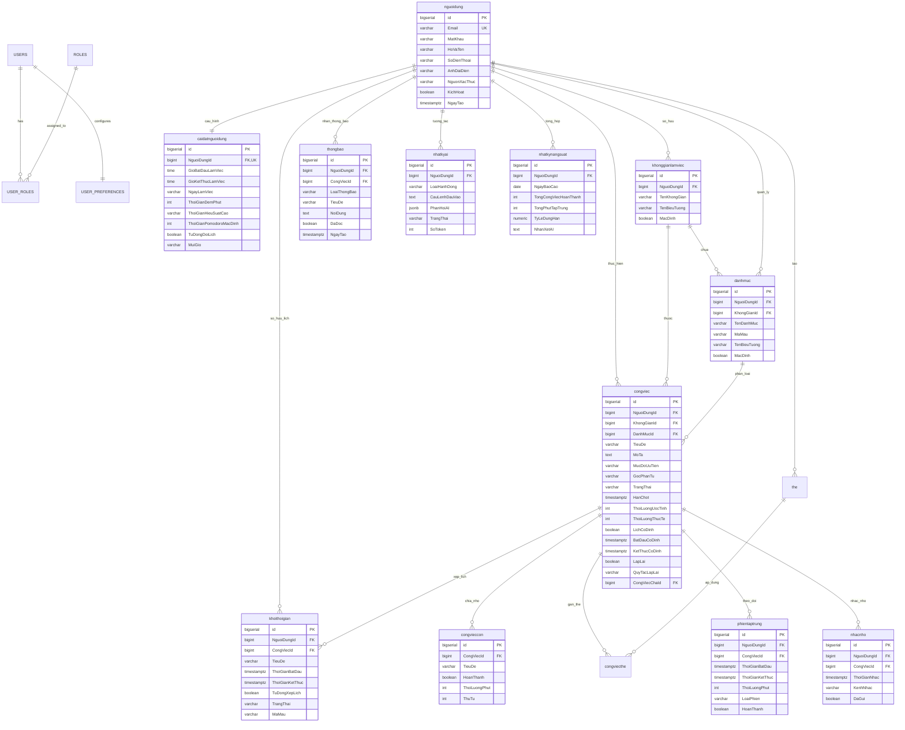
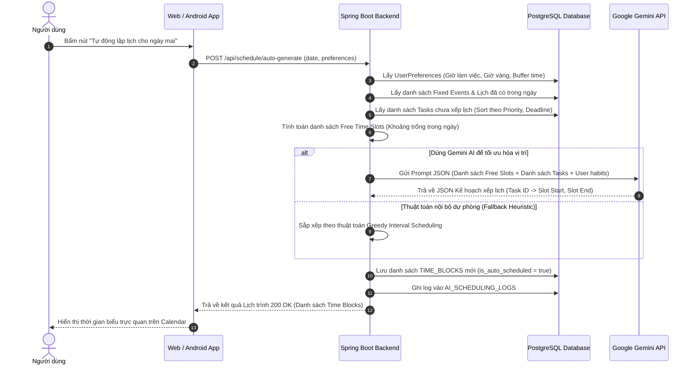

# BÁO CÁO NGHIÊN CỨU & ĐẶC TẢ THIẾT KẾ HỆ THỐNG
# PHẦN MỀM QUẢN LÝ VÀ TỰ ĐỘNG LẬP LỊCH CÔNG VIỆC CÁ NHÂN (SMARTTASK AI)

---

## MỤC LỤC
1. [TÌM HIỂU ĐỀ TÀI & TỔNG QUAN HỆ THỐNG](#1-tìm-hiểu-đề-tài--tổng-quan-hệ-thống)
   - 1.1. Bối cảnh và tính cấp thiết của đề tài
   - 1.2. Mục tiêu nghiên cứu và phát triển
   - 1.3. Khảo sát hiện trạng và so sánh các giải pháp
   - 1.4. Điểm đột phá: Ứng dụng Gemini AI trong quản lý công việc và tự động lập lịch
2. [XÁC ĐỊNH CÁC CHỨC NĂNG HỆ THỐNG](#2-xác-định-các-chức-năng-hệ-thống)
   - 2.1. Phân hệ Quản lý Tài khoản & Cá nhân hóa (Auth & Preferences)
   - 2.2. Phân hệ Quản lý Nhiệm vụ & Danh mục (Tasks, Subtasks, Categories)
   - 2.3. Phân hệ Trợ lý AI & Động cơ Lập lịch Tự động (AI Smart Auto-Scheduling Engine)
   - 2.4. Phân hệ Lịch biểu tương tác & Khối thời gian (Calendar & Time-Blocking)
   - 2.5. Phân hệ Tập trung Pomodoro & Theo dõi thời gian (Focus Sessions)
   - 2.6. Phân hệ Thông báo & Nhắc nhở (Notification & Reminders)
   - 2.7. Phân hệ Thống kê & Đánh giá năng suất (Productivity Analytics & AI Insights)
   - 2.8. Yêu cầu phi chức năng (Non-Functional Requirements)
3. [MÔ HÌNH HÓA CƠ SỞ DỮ LIỆU (DATABASE MODELING - POSTGRESQL 17)](#3-mô-hình-hóa-cơ-sở-dữ-liệu-database-modeling---postgresql-17)
   - 3.1. Sơ đồ Quan hệ Thực thể (ERD - Entity Relationship Diagram)
   - 3.2. Đặc tả chi tiết các bảng dữ liệu
   - 3.3. Các chỉ mục (Indexes) và chiến lược tối ưu hóa
4. [KIẾN TRÚC KỸ THUẬT & LUỒNG HOẠT ĐỘNG](#4-kiến-trúc-kỹ-thuật--luồng-hoạt-động)
   - 4.1. Kiến trúc hệ thống tổng thể (System Architecture)
   - 4.2. Sơ đồ luồng hoạt động Lập lịch tự động (Auto-Scheduling Flow)
   - 4.3. Đặc tả các RESTful API cốt lõi
5. [CẤU TRÚC THƯ MỤC DỰ ÁN](#5-cấu-trúc-thư-mục-dự-án)
   - 5.1. Mô hình cấu trúc tổ chức dự án kế thừa và phát triển
   - 5.2. Cấu trúc Backend (Java Spring Boot 3 + Maven)
   - 5.3. Cấu trúc Frontend (ReactJS + TypeScript + Vite)
   - 5.4. Cấu trúc Android App (Kotlin + Jetpack Compose)
   - 5.5. Hướng dẫn khởi chạy và vận hành hệ thống

---

## 1. TÌM HIỂU ĐỀ TÀI & TỔNG QUAN HỆ THỐNG

### 1.1. Bối cảnh và tính cấp thiết của đề tài
Trong kỷ nguyên số và môi trường làm việc hiện đại, con người phải đối mặt với khối lượng thông tin và công việc khổng lồ mỗi ngày. Các vấn đề phổ biến nhất mà học sinh, sinh viên và người đi làm gặp phải gồm:
- **Hội chứng trì hoãn (Procrastination):** Khó khăn trong việc bắt đầu do công việc quá phức tạp hoặc chưa được chia nhỏ.
- **Nghịch lý thời gian (Planning Fallacy & Parkinson's Law):** Đánh giá sai thời lượng cần thiết để hoàn thành một nhiệm vụ; công việc thường bị kéo dài lấp đầy toàn bộ thời gian cho phép.
- **Quá tải nhận thức (Cognitive Overload):** Khi có quá nhiều đầu việc dồn dập, con người mất khả năng xác định việc gì cần làm trước (Khẩn cấp vs Quan trọng).
- **Lập lịch thụ động (Passive Scheduling):** Các ứng dụng Todo truyền thống (Google Tasks, Todoist, Microsoft To-Do) chỉ hoạt động như một "sổ tay điện tử" ghi chép. Người dùng vẫn phải tự tính toán giờ rảnh, tự nhấc từng công việc bỏ vào lịch; khi có việc đột xuất phát sinh, toàn bộ lịch bị phá vỡ và người dùng bỏ cuộc vì việc sắp xếp lại quá mất thời gian.

### 1.2. Mục tiêu nghiên cứu và phát triển
Dự án hướng đến việc xây dựng một hệ thống **Quản lý và Tự động Lập lịch Công việc Cá nhân Đa nền tảng (Web + Android Mobile)** mang tên **SmartTask AI**:
1. **Quản lý toàn diện:** Giúp người dùng ghi chép, phân loại và theo dõi tiến độ công việc một cách trực quan, khoa học.
2. **Tự động lập lịch (Auto-Scheduling Engine):** Dựa trên mức độ ưu tiên, hạn chót (Deadline), thời lượng ước tính và thói quen sinh hoạt (khung giờ làm việc, giờ vàng tập trung, thời gian đệm), thuật toán sẽ tự động phân bổ công việc vào các khoảng thời gian trống (Time-blocking).
3. **Ứng dụng Trí tuệ Nhân tạo (Google Gemini API):**
   - Phân tích câu lệnh ngôn ngữ tự nhiên thành công việc có cấu trúc.
   - Tự động phân rã (Breakdown) một mục tiêu lớn thành các nhiệm vụ con cụ thể.
   - Đưa ra giải pháp dời lịch (Rescheduling) thông minh khi có sự cố hoặc trễ hạn.
   - Tổng kết và đưa ra lời khuyên cải thiện năng suất hằng ngày.
4. **Đồng bộ thời gian thực:** Đồng bộ dữ liệu mượt mà giữa ứng dụng Web (ReactJS + TypeScript) và ứng dụng di động (Android Kotlin + Jetpack Compose) thông qua RESTful API an toàn bảo mật.

### 1.3. Khảo sát hiện trạng và so sánh các giải pháp

| Tiêu chí | Todoist / Google Tasks | Notion / Trello | Motion / Reclaim.ai | **SmartTask AI (Hệ thống đề tài)** |
| :--- | :--- | :--- | :--- | :--- |
| **Loại hình quản lý** | Danh sách việc cần làm (Checklist đơn thuần) | Bảng Kanban / Wiki dữ liệu | Lập lịch thông minh | Tích hợp To-do + Time Blocking + Lập lịch AI |
| **Cơ chế lập lịch** | Thủ công | Thủ công | Tự động (Đắt đỏ, trả phí cao) | **Tự động thông minh + Tùy biến linh hoạt** |
| **Ứng dụng AI** | Hỗ trợ tìm kiếm cơ bản | Tóm tắt văn bản | Lập lịch tự động độc quyền | **Gemini API: Phân rã Task, Đặt lịch, Phân tích thói quen** |
| **Phương pháp tập trung**| Không tích hợp sẵn | Cần plugin bên ngoài | Giới hạn | **Tích hợp sẵn Đồng hồ Pomodoro liên kết Task** |
| **Nền tảng hỗ trợ** | Web / Mobile | Web / Mobile | Chủ yếu Web / Extension | **Đồng bộ Web (React TS) & Mobile (Android Compose)** |
| **Chi phí** | Miễn phí / Thu phí | Miễn phí / Thu phí | Giá rất cao (19$ - 34$/tháng)| **Mã nguồn mở, chi phí vận hành tối ưu** |

### 1.4. Điểm đột phá: Ứng dụng Gemini AI trong đề tài
- **Prompt Engineering chuyên biệt:** Tích hợp mô hình `gemini-1.5-flash` xử lý tốc độ cao và phản hồi theo định dạng JSON có cấu trúc (JSON Mode) giúp Backend Java Spring Boot dễ dàng parse dữ liệu và lưu trực tiếp vào cơ sở dữ liệu.
- **Khả năng tự phục hồi lịch trình (Dynamic Conflict Resolution):** Khi người dùng báo bận đột xuất hoặc có công việc kéo dài hơn dự kiến, hệ thống AI tự động điều chuyển các công việc có độ ưu tiên thấp hơn sang các slot trống kế tiếp mà không vi phạm các hạn chót nghiêm ngặt (Hard Deadlines).

---

## 2. XÁC ĐỊNH CÁC CHỨC NĂNG HỆ THỐNG

### 2.1. Phân hệ Quản lý Tài khoản & Cá nhân hóa (Auth & Preferences)
- **Đăng ký / Đăng nhập:** Xác thực qua JWT (Access Token & Refresh Token), mã hóa mật khẩu bằng BCrypt.
- **Quản lý Hồ sơ Cá nhân:** Cập nhật thông tin họ tên, email, ảnh đại diện (Avatar).
- **Cấu hình thói quen sinh hoạt (User Preferences):**
  - Khung giờ làm việc cố định (Ví dụ: 08:00 - 18:00).
  - Các ngày làm việc trong tuần (Thứ 2 đến Thứ 6).
  - Khung giờ vàng tập trung (Peak Productivity Hours: Buổi sáng, Buổi chiều hoặc Buổi tối).
  - Thời gian đệm an toàn giữa hai công việc (Buffer Time: 10 - 15 phút).
  - Cấu hình thời gian Pomodoro (25 phút làm việc, 5 phút nghỉ ngắn, 15 phút nghỉ dài).

### 2.2. Phân hệ Quản lý Nhiệm vụ & Danh mục (Tasks, Subtasks, Categories)
- **Quản lý Danh mục (Categories) & Thẻ (Tags):** Phân loại công việc theo lĩnh vực (Công việc, Học tập, Sức khỏe, Cá nhân) với màu sắc và biểu tượng nhận diện.
- **Quản lý Công việc (Tasks):**
  - CRUD công việc với đầy đủ thuộc tính: Tiêu đề, Mô tả, Hạn chót (Due Date), Thời lượng ước tính (Estimated Duration), Độ ưu tiên (Low, Medium, High, Urgent).
  - Phân loại ma trận Eisenhower (Quan trọng - Khẩn cấp).
  - Thiết lập công việc cố định (Fixed Time Event - ví dụ: Lịch họp, lịch học không thể dịch chuyển) và công việc linh hoạt (Flexible Tasks - AI có thể tự do xếp lịch).
  - Quản lý công việc định kỳ (Recurring Tasks: Lặp lại hằng ngày, hằng tuần).
- **Nhiệm vụ con (Subtasks / Checklist):** Phân rã công việc thành từng bước thực hiện nhỏ có checkbox hoàn thành.

### 2.3. Phân hệ Trợ lý AI & Động cơ Lập lịch Tự động (AI Smart Auto-Scheduling Engine)
- **Phân rã công việc bằng AI (AI Task Breakdown):**
  - Người dùng nhập một mục tiêu chung (Ví dụ: *"Chuẩn bị báo cáo tài chính quý 3"*).
  - Gemini API tự động phân tích và tạo ra danh sách 4 - 6 bước con cụ thể kèm theo thời lượng dự kiến cho từng bước.
- **Nhập liệu nhanh bằng ngôn ngữ tự nhiên (Natural Language Parsing):**
  - Người dùng nhập: *"Chiều mai 3h họp nhóm đồ án 45 phút ưu tiên cao"*.
  - AI tự trích xuất: Title = "Họp nhóm đồ án", Time = "15:00 ngày mai", Duration = 45 phút, Priority = "HIGH", Type = "FIXED".
- **Tự động xếp lịch thông minh (Smart Auto-Scheduler):**
  - Quét toàn bộ công việc chưa có lịch trong ngày/tuần.
  - Phân tích các khoảng thời gian trống (Free Slots) giữa các lịch cố định và thời gian làm việc.
  - Xếp các việc quan trọng nhất vào khung giờ vàng của người dùng.
- **Tự động dời lịch khi trễ hạn (Smart Reschedule):**
  - Khi một công việc bị trễ hoặc người dùng bấm nút *"Quá tải / Tối ưu lại lịch"*, AI tự động sắp xếp lại các công việc còn lại vào các khung giờ tiếp theo một cách hợp lý nhất.

### 2.4. Phân hệ Lịch biểu tương tác & Khối thời gian (Calendar & Time-Blocking)
- **Chế độ xem đa dạng:** Xem lịch theo Ngày (Day), Tuần (Week), Tháng (Month) và Lịch trình dạng danh sách (Timeline Agenda).
- **Kéo thả trực quan (Interactive Drag-and-Drop):** Cho phép người dùng kéo thả để thay đổi giờ hoặc kéo dài thời lượng khối thời gian trên giao diện Web.
- **Trạng thái khối thời gian:** Đã lên lịch (Scheduled), Đang thực hiện (In Progress), Đã hoàn thành (Completed), Bị hủy (Cancelled).

### 2.5. Phân hệ Tập trung Pomodoro & Theo dõi thời gian (Focus Sessions)
- **Đồng hồ bấm giờ Pomodoro:** Đếm ngược thời gian làm việc chuẩn khoa học (25 phút tập trung - 5 phút nghỉ).
- **Liên kết trực tiếp với Công việc:** Chọn một công việc cụ thể khi bấm bắt đầu Pomodoro.
- **Ghi nhận thời lượng thực tế (Actual Duration):** Hệ thống tự động cộng dồn thời gian đã làm việc vào công việc tương ứng để so sánh với thời lượng ước tính ban đầu.

### 2.6. Phân hệ Thông báo & Nhắc nhở (Notification & Reminders)
- **Nhắc nhở trước hạn:** Thông báo trước 15 phút, 30 phút, 1 giờ hoặc 1 ngày trước khi công việc bắt đầu hoặc đến deadline.
- **Đa kênh thông báo:**
  - Local Push Notification trên Android (qua `AlarmManager` / `NotificationManager`).
  - Web in-app Notification và Web Push Notification.
- **Bản tin đầu ngày (Daily Briefing):** Tóm tắt các nhiệm vụ quan trọng cần hoàn thành trong ngày vào lúc 07:30 sáng.

### 2.7. Phân hệ Thống kê & Đánh giá năng suất (Productivity Analytics & AI Insights)
- **Biểu đồ tỷ lệ hoàn thành:** So sánh số việc hoàn thành đúng hạn vs trễ hạn.
- **Biểu đồ thời gian tập trung:** Tổng số phút Pomodoro theo ngày/tuần.
- **Phân bổ thời gian theo Danh mục:** Xem người dùng dành bao nhiêu % thời gian cho Công việc, Học tập hay Cá nhân.
- **Đánh giá năng suất bằng AI (AI Weekly Insights):** Gemini phân tích dữ liệu tuần và đưa ra nhận xét: *"Bạn làm việc hiệu quả nhất vào buổi sáng, nhưng thường đánh giá thấp thời gian làm việc cho các việc học tập 30%. Khuyến nghị bạn tăng thời gian ước tính thêm 15 phút."*

### 2.8. Yêu cầu phi chức năng (Non-Functional Requirements)
- **Hiệu năng (Performance):** Thời gian phản hồi API < 200ms cho các truy vấn thông thường; quá trình AI lập lịch xử lý bất đồng bộ < 3 giây.
- **Bảo mật (Security):** Mật khẩu mã hóa BCrypt, giao tiếp an toàn qua HTTPS, xác thực bằng JWT Bearer Token, kiểm soát truy cập phân quyền nghiêm ngặt.
- **Độ tin cậy & Sẵn sàng (Reliability):** Cơ sở dữ liệu PostgreSQL có ràng buộc toàn vẹn, hỗ trợ giao dịch (ACID Transactions), sao lưu định kỳ.
- **Trải nghiệm người dùng (UX/UI):** Giao diện hiện đại, tối giản, hỗ trợ Dark Mode / Light Mode, thân thiện trên cả màn hình máy tính và thiết bị di động.

---

## 3. MÔ HÌNH HÓA CƠ SỞ DỮ LIỆU (DATABASE MODELING - POSTGRESQL 17)

### 3.1. Sơ đồ Quan hệ Thực thể (ERD - Entity Relationship Diagram)



### 3.2. Đặc tả chi tiết các bảng dữ liệu (Quy chuẩn tiếng Việt)

> **Quy tắc chuẩn hóa CSDL:**
> - **Tên bảng:** Viết thường toàn bộ (`nguoidung`, `congviec`, `khoithoigian`, `danhmuc`, `thongbao`...), không dùng dấu gạch dưới `_`.
> - **Tên thuộc tính (cột):** Viết hoa các âm (`HoVaTen`, `MatKhau`, `HanChot`, `TieuDe`, `NgayTao`...), không dùng dấu gạch dưới `_`.

#### Bảng 1: `nguoidung` (Người dùng & Tài khoản hệ thống)
| Tên cột | Kiểu dữ liệu | Ràng buộc | Mô tả ý nghĩa |
| :--- | :--- | :--- | :--- |
| `id` | `BIGSERIAL` | PRIMARY KEY | Khóa chính định danh người dùng |
| `Email` | `VARCHAR(120)`| NOT NULL, UNIQUE | Địa chỉ email đăng nhập |
| `MatKhau` | `VARCHAR(255)`| NOT NULL | Mật khẩu băm bằng thuật toán BCrypt |
| `HoVaTen` | `VARCHAR(100)`| NOT NULL | Họ và tên hiển thị của người dùng (ví dụ: *"Minh Anh"*) |
| `SoDienThoai` | `VARCHAR(20)` | NULL | Số điện thoại liên hệ |
| `AnhDaiDien` | `VARCHAR(500)`| NULL | Đường dẫn URL ảnh đại diện |
| `NguonXacThuc` | `VARCHAR(20)` | DEFAULT 'LOCAL' | Phương thức xác thực: LOCAL hoặc GOOGLE |
| `KichHoat` | `BOOLEAN` | DEFAULT TRUE | Trạng thái hoạt động tài khoản |
| `XacThucEmail` | `BOOLEAN` | DEFAULT FALSE | Trạng thái xác thực email |
| `NgayTao` | `TIMESTAMPTZ` | DEFAULT CURRENT_TIMESTAMP | Thời điểm tạo tài khoản |
| `NgayCapNhat` | `TIMESTAMPTZ` | DEFAULT CURRENT_TIMESTAMP | Thời điểm cập nhật cuối |

#### Bảng 2: `vaitro` & `vaitronguoidung` (Phân quyền bảo mật RBAC)
- **`vaitro`:** Chứa danh sách các quyền hạn (`ROLE_USER`, `ROLE_ADMIN`).
- **`vaitronguoidung`:** Bảng trung gian thể hiện quan hệ N-N giữa `nguoidung` và `vaitro`.

#### Bảng 3: `caidatnguoidung` (Cấu hình thói quen làm việc & AI)
| Tên cột | Kiểu dữ liệu | Ràng buộc | Mô tả ý nghĩa |
| :--- | :--- | :--- | :--- |
| `id` | `BIGSERIAL` | PRIMARY KEY | Khóa chính cấu hình |
| `NguoiDungId` | `BIGINT` | NOT NULL, UNIQUE, FK -> nguoidung(id) | Liên kết 1-1 với người dùng |
| `GioBatDauLamViec`| `TIME` | DEFAULT '08:00:00' | Giờ bắt đầu làm việc trong ngày |
| `GioKetThucLamViec`| `TIME` | DEFAULT '18:00:00' | Giờ kết thúc làm việc trong ngày |
| `NgayLamViec` | `VARCHAR(50)` | DEFAULT 'MON,TUE,WED,THU,FRI' | Danh sách các ngày làm việc |
| `ThoiGianDemPhut` | `INT` | DEFAULT 15 | Thời gian đệm nghỉ giữa 2 việc (phút) |
| `ThoiGianHieuSuatCao`| `VARCHAR(20)`| DEFAULT 'MORNING' | Khung giờ làm việc hiệu quả nhất: MORNING, AFTERNOON, EVENING |
| `ThoiGianPomodoroMacDinh`| `INT`| DEFAULT 25 | Thời lượng mỗi phiên Pomodoro |
| `TuDongDoiLich` | `BOOLEAN` | DEFAULT TRUE | Bật/Tắt tự động dời việc khi trễ |
| `MuiGio` | `VARCHAR(50)` | DEFAULT 'Asia/Ho_Chi_Minh' | Múi giờ của người dùng |

#### Bảng 4: `khonggianlamviec` (Không gian làm việc độc lập)
| Tên cột | Kiểu dữ liệu | Ràng buộc | Mô tả ý nghĩa |
| :--- | :--- | :--- | :--- |
| `id` | `BIGSERIAL` | PRIMARY KEY | Khóa chính không gian |
| `NguoiDungId` | `BIGINT` | NOT NULL, FK -> nguoidung(id) | Người sở hữu không gian |
| `TenKhongGian` | `VARCHAR(100)`| NOT NULL | Tên không gian làm việc (Không gian cá nhân, Đồ án tốt nghiệp...) |
| `TenBieuTuong` | `VARCHAR(50)` | DEFAULT 'Briefcase' | Biểu tượng không gian làm việc |
| `MacDinh` | `BOOLEAN` | DEFAULT FALSE | Đánh dấu không gian mặc định |

#### Bảng 5: `danhmuc` (Danh mục công việc)
| Tên cột | Kiểu dữ liệu | Ràng buộc | Mô tả ý nghĩa |
| :--- | :--- | :--- | :--- |
| `id` | `BIGSERIAL` | PRIMARY KEY | Khóa chính danh mục |
| `NguoiDungId` | `BIGINT` | NOT NULL, FK -> nguoidung(id) | Người sở hữu danh mục |
| `KhongGianId` | `BIGINT` | NULL, FK -> khonggianlamviec(id) | Thuộc không gian làm việc nào |
| `TenDanhMuc` | `VARCHAR(100)`| NOT NULL | Tên danh mục (Học tập, Công việc, Sức khỏe...) |
| `MaMau` | `VARCHAR(20)` | DEFAULT '#4F46E5' | Mã màu HEX hiển thị trên giao diện |
| `TenBieuTuong` | `VARCHAR(50)` | DEFAULT 'Folder' | Tên icon biểu tượng |
| `MacDinh` | `BOOLEAN` | DEFAULT FALSE | Đánh dấu danh mục mặc định của hệ thống |

#### Bảng 6: `congviec` (Công việc / Nhiệm vụ chính)
| Tên cột | Kiểu dữ liệu | Ràng buộc | Mô tả ý nghĩa |
| :--- | :--- | :--- | :--- |
| `id` | `BIGSERIAL` | PRIMARY KEY | Khóa chính định danh nhiệm vụ |
| `NguoiDungId` | `BIGINT` | NOT NULL, FK -> nguoidung(id) | Người sở hữu nhiệm vụ |
| `KhongGianId` | `BIGINT` | NOT NULL, FK -> khonggianlamviec(id) | Không gian làm việc trực thuộc |
| `DanhMucId` | `BIGINT` | NULL, FK -> danhmuc(id) | Danh mục phân loại nhiệm vụ |
| `TieuDe` | `VARCHAR(255)`| NOT NULL | Tiêu đề công việc |
| `MoTa` | `TEXT` | NULL | Chi tiết mô tả hoặc ghi chú công việc |
| `MucDoUuTien` | `VARCHAR(20)` | DEFAULT 'MEDIUM' | Mức độ ưu tiên: LOW, MEDIUM, HIGH, URGENT |
| `GocPhanTu` | `VARCHAR(20)` | DEFAULT 'SCHEDULE' | Ma trận Eisenhower: DO_FIRST, SCHEDULE, DELEGATE, DONT_DO |
| `TrangThai` | `VARCHAR(20)` | DEFAULT 'TODO' | Trạng thái: TODO, IN_PROGRESS, COMPLETED, CANCELLED, OVERDUE |
| `HanChot` | `TIMESTAMPTZ` | NULL | Hạn chót hoàn thành (Deadline) |
| `ThoiLuongUocTinh`| `INT` | DEFAULT 30 | Thời lượng ước tính cần để làm xong (phút) |
| `ThoiLuongThucTe` | `INT` | DEFAULT 0 | Thời lượng thực tế đã thực hiện (phút) |
| `LichCoDinh` | `BOOLEAN` | DEFAULT FALSE | Đánh dấu lịch cố định (họp, thi) không được tự dời |
| `BatDauCoDinh` | `TIMESTAMPTZ` | NULL | Thời điểm bắt đầu cố định |
| `KetThucCoDinh` | `TIMESTAMPTZ` | NULL | Thời điểm kết thúc cố định |
| `LapLai` | `BOOLEAN` | DEFAULT FALSE | Đánh dấu công việc lặp lại định kỳ |
| `QuyTacLapLai` | `VARCHAR(100)`| NULL | Quy tắc lặp (DAILY, WEEKLY_MON_WED_FRI) |
| `CongViecChaId` | `BIGINT` | NULL, FK -> congviec(id) | Khóa ngoại trỏ đến công việc cha |
| `HoanThanhLuc` | `TIMESTAMPTZ` | NULL | Thời điểm hoàn thành nhiệm vụ |

#### Bảng 7: `congvieccon` (Công việc con / Checklist)
- `id` (BIGSERIAL PK), `CongViecId` (FK -> congviec), `TieuDe` (VARCHAR), `HoanThanh` (BOOLEAN), `ThoiLuongPhut` (INT), `ThuTu` (INT).

#### Bảng 8: `khoithoigian` (Khối thời gian trên lịch 0:00 - 23:59)
- `id` (BIGSERIAL PK), `NguoiDungId` (FK -> nguoidung), `CongViecId` (FK -> congviec), `TieuDe` (VARCHAR), `ThoiGianBatDau` (TIMESTAMPTZ), `ThoiGianKetThuc` (TIMESTAMPTZ), `TuDongXepLich` (BOOLEAN), `TrangThai` (SCHEDULED, IN_PROGRESS, COMPLETED, CANCELLED), `MaMau` (VARCHAR), `GhiChu` (TEXT).

#### Bảng 9: `phientaptrung` (Phiên tập trung Pomodoro)
- `id` (BIGSERIAL PK), `NguoiDungId` (FK -> nguoidung), `CongViecId` (FK -> congviec), `ThoiGianBatDau` (TIMESTAMPTZ), `ThoiGianKetThuc` (TIMESTAMPTZ), `ThoiLuongPhut` (INT), `LoaiPhien` (WORK, SHORT_BREAK, LONG_BREAK), `HoanThanh` (BOOLEAN).

#### Bảng 10: `nhacnho` (Cấu hình thông báo nhắc nhở)
- `id` (BIGSERIAL PK), `NguoiDungId` (FK -> nguoidung), `CongViecId` (FK -> congviec), `ThoiGianNhac` (TIMESTAMPTZ), `KenhNhac` (PUSH, EMAIL, IN_APP), `DaGui` (BOOLEAN).

#### Bảng 11: `thongbao` (Thông báo hệ thống & Thuật toán quyết định)
- `id` (BIGSERIAL PK), `NguoiDungId` (FK -> nguoidung), `CongViecId` (FK -> congviec), `LoaiThongBao` (reminder, ai, alert, success), `TieuDe` (VARCHAR), `NoiDung` (TEXT), `DaDoc` (BOOLEAN), `NgayTao` (TIMESTAMPTZ).

#### Bảng 12: `nhatkyai` (Nhật ký xử lý của Gemini API)
- `id` (BIGSERIAL PK), `NguoiDungId` (FK -> nguoidung), `LoaiHanhDong` (VARCHAR), `CauLenhDauVao` (TEXT), `PhanHoiAI` (JSONB), `TrangThai` (VARCHAR), `SoToken` (INT), `ThoiGianXuLyMs` (BIGINT).

#### Bảng 13: `nhatkynangsuat` (Thống kê năng suất ngày)
- `id` (BIGSERIAL PK), `NguoiDungId` (FK -> nguoidung), `NgayBaoCao` (DATE), `TongCongViecHoanThanh` (INT), `TongPhutTapTrung` (INT), `TyLeDungHan` (NUMERIC(5,2)), `NhanXetAI` (TEXT).

### 3.3. Các chỉ mục (Indexes) và chiến lược tối ưu hóa
1. `idx_congviec_nguoidung_trangthai` trên `("NguoiDungId", "TrangThai")`: Tối ưu hóa truy vấn lấy danh sách việc cần làm (`TODO`, `IN_PROGRESS`).
2. `idx_congviec_nguoidung_hanchot` trên `("NguoiDungId", "HanChot")`: Hỗ trợ tìm kiếm các việc sắp đến hạn hoặc quá hạn nhanh chóng.
3. `idx_khoithoigian_nguoidung_thoigian` trên `("NguoiDungId", "ThoiGianBatDau", "ThoiGianKetThuc")`: Tối ưu hóa truy vấn kiểm tra xung đột thời gian và hiển thị lịch tuần 0:00 - 23:59.
4. `idx_thongbao_nguoidung_dadoc` trên `("NguoiDungId", "DaDoc")`: Tối ưu hóa đếm số lượng thông báo chưa đọc.

---

## 4. KIẾN TRÚC KỸ THUẬT & LUỒNG HOẠT ĐỘNG

### 4.1. Kiến trúc hệ thống tổng thể (System Architecture)

```
┌─────────────────────────────────┐        ┌──────────────────────────────────┐
│   Web Client (React + TS)       │        │  Android Client (Jetpack Compose)│
│  - React Router, Axios, Lucide  │        │  - Retrofit, Room DB, ViewModel  │
│  - FullCalendar, Pomodoro Timer │        │  - NotificationManager, Coroutine│
└────────────────┬────────────────┘        └─────────────────┬────────────────┘
                 │                                           │
                 │               RESTful APIs / JSON         │
                 └─────────────────────┬─────────────────────┘
                                       │
                                       ▼
┌─────────────────────────────────────────────────────────────────────────────┐
│                       BACKEND (Java - Spring Boot 3)                        │
│                                                                             │
│  ┌───────────────────────┐  ┌───────────────────────┐  ┌─────────────────┐  │
│  │    Security & Filter   │  │    REST Controllers   │  │ DTO & Validation│  │
│  │ (Spring Security, JWT)│  │ (Auth, Task, Schedule)│  │ (Bean Validation│  │
│  └───────────┬───────────┘  └───────────┬───────────┘  └─────────────────┘  │
│              │                          │                                   │
│              ▼                          ▼                                   │
│  ┌──────────────────────────────────────────────────┐                       │
│  │                   Service Layer                  │                       │
│  │ - TaskService, ScheduleService, PomodoroService   │                       │
│  │ - Smart Auto-Scheduling Engine (Slot Finder)      │                       │
│  └───────────┬──────────────────────────┬───────────┘                       │
│              │                          │                                   │
│              ▼                          ▼                                   │
│  ┌───────────────────────┐  ┌───────────────────────┐                       │
│  │ Data JPA (Hibernate)  │  │   Gemini AI Client    │                       │
│  │ Spring Data Repos     │  │ WebClient / REST API  │                       │
│  └───────────┬───────────┘  └───────────┬───────────┘                       │
└──────────────┼──────────────────────────┼───────────────────────────────────┘
               │                          │
               ▼                          ▼
┌───────────────────────────────┐ ┌───────────────────────────────────────────┐
│ Database: PostgreSQL 17.11    │ │ External Service: Google Gemini API       │
│ - Port: 5432                  │ │ - Model: gemini-1.5-flash                 │
│ - Database: quanlycongviec_db │ │ - Nhiệm vụ: Task Breakdown, Auto-Schedule │
└───────────────────────────────┘ └───────────────────────────────────────────┘
```

### 4.2. Sơ đồ luồng hoạt động Lập lịch tự động (Auto-Scheduling Flow)



### 4.3. Đặc tả các RESTful API cốt lõi

#### Nhóm 1: Xác thực & Người dùng (`/api/auth`, `/api/users`)
- `POST /api/auth/register`: Đăng ký tài khoản mới.
- `POST /api/auth/login`: Đăng nhập, nhận JWT Token.
- `GET /api/users/profile`: Lấy thông tin cá nhân của người dùng hiện tại.
- `PUT /api/users/preferences`: Cập nhật cấu hình thói quen làm việc (giờ làm, giờ vàng, buffer).

#### Nhóm 2: Quản lý Công việc & Danh mục (`/api/tasks`, `/api/categories`)
- `GET /api/tasks`: Lấy danh sách công việc (hỗ trợ lọc theo `status`, `category_id`, `priority`, `due_date`).
- `POST /api/tasks`: Tạo công việc mới.
- `PUT /api/tasks/{id}`: Cập nhật thông tin công việc.
- `PATCH /api/tasks/{id}/status`: Cập nhật nhanh trạng thái (`COMPLETED`, `IN_PROGRESS`).
- `DELETE /api/tasks/{id}`: Xóa công việc.
- `POST /api/tasks/{id}/subtasks`: Thêm checklist con vào công việc.

#### Nhóm 3: Trợ lý AI & Lập lịch tự động (`/api/ai`, `/api/schedule`)
- `POST /api/ai/parse-task`: Phân tích câu nói/văn bản tự nhiên thành công việc có cấu trúc.
- `POST /api/ai/breakdown-task`: Phân rã mục tiêu lớn thành các subtask bằng Gemini API.
- `POST /api/schedule/auto-generate`: Chạy thuật toán tự động xếp các task chưa lập lịch vào ngày chỉ định.
- `POST /api/schedule/reschedule-conflicts`: Tự động dời các việc bị trễ hoặc xung đột.
- `GET /api/schedule/time-blocks`: Lấy danh sách khối thời gian hiển thị lên Calendar.

#### Nhóm 4: Pomodoro & Thống kê (`/api/pomodoro`, `/api/analytics`)
- `POST /api/pomodoro/start`: Bắt đầu phiên tập trung mới (liên kết với Task ID).
- `POST /api/pomodoro/complete`: Kết thúc phiên tập trung và ghi nhận số phút thực tế.
- `GET /api/analytics/summary`: Lấy dữ liệu tổng hợp số việc đã hoàn thành, tỷ lệ đúng hạn, tổng phút tập trung.
- `GET /api/analytics/ai-insights`: Lấy báo cáo phân tích nhận xét thói quen làm việc từ Gemini AI.

---

## 5. CẤU TRÚC THƯ MỤC DỰ ÁN

Cấu trúc dự án được thiết kế đồng bộ, kế thừa tiêu chuẩn phân chia từ mô hình tham chiếu `D:\WEBSITE_BANLINHKIENMAYTINH` với 3 phân hệ độc lập: **Backend**, **Frontend**, **Android**, cùng thư mục tiện ích **Tools** và kịch bản khởi tạo **Database**.

### 5.1. Sơ đồ Cây Thư mục Dự án Tổng thể

```
d:\DACN_QUANLYCONGVIECCANHAN\
├── backend\                             # Backend Java Spring Boot 3
│   ├── src\
│   │   ├── main\
│   │   │   ├── java\com\taskmanager\
│   │   │   │   ├── client\gemini\       # Client gọi Gemini API (JSON Prompting & Parser)
│   │   │   │   ├── config\              # Cấu hình Spring (Cors, Security, Bean Config)
│   │   │   │   ├── controller\          # REST Controllers tiếp nhận request API
│   │   │   │   ├── dto\
│   │   │   │   │   ├── request\         # DTO tiếp nhận dữ liệu đầu vào
│   │   │   │   │   └── response\        # DTO trả về kết quả cho Frontend/Mobile
│   │   │   │   ├── entity\              # JPA Entities ánh xạ bảng PostgreSQL
│   │   │   │   ├── exception\           # Xử lý lỗi toàn cục (Global Exception Handler)
│   │   │   │   ├── repository\          # Spring Data JPA Repositories
│   │   │   │   ├── security\            # Cấu hình JWT Filter, UserDetails, AuthToken
│   │   │   │   ├── service\             # Interface tầng nghiệp vụ
│   │   │   │   │   └── impl\            # Implementation triển khai nghiệp vụ
│   │   │   │   ├── utils\               # Tiện ích bổ trợ (DateTime, Scheduling Algorithm)
│   │   │   │   └── TaskManagerApplication.java
│   │   │   └── resources\
│   │   │       ├── application.properties # Cấu hình DB PostgreSQL 17.11, JWT, Gemini API
│   │   └── test\                        # Unit Test & Integration Test
│   └── pom.xml                          # Maven dependencies (Spring Boot, JPA, Postgres, JJWT)
│
├── frontend\                            # Web Frontend (ReactJS + TypeScript + Vite)
│   ├── public\                          # Tài nguyên tĩnh (Favicon, Logo, Assets)
│   ├── src\
│   │   ├── components\                  # Các components tái sử dụng
│   │   │   ├── ai\                      # AI Assistant dialog, Task Breakdown modal
│   │   │   ├── calendar\                # Giao diện Lịch Time-blocking (Day, Week, Month)
│   │   │   ├── common\                  # Nút bấm, Ô nhập, Modal, Spinner dùng chung
│   │   │   ├── pomodoro\                # Đồng hồ đếm ngược Pomodoro
│   │   │   └── task\                    # Thẻ công việc, Form thêm/sửa, Checklist
│   │   ├── context\                     # State management (AuthContext, ThemeContext)
│   │   ├── hooks\                       # Custom React Hooks (useTasks, useSchedule)
│   │   ├── layouts\                     # Khung layout (Sidebar, Header, MainLayout)
│   │   ├── pages\                       # Các trang màn hình chính
│   │   │   ├── auth\                    # Màn hình Đăng nhập / Đăng ký
│   │   │   ├── calendar\                # Màn hình Lịch biểu Time-blocking
│   │   │   ├── dashboard\               # Màn hình Trang chủ tổng quan
│   │   │   ├── pomodoro\                # Màn hình Tập trung Pomodoro
│   │   │   ├── settings\                # Màn hình Cài đặt thói quen & Múi giờ
│   │   │   ├── statistics\              # Màn hình Biểu đồ báo cáo hiệu suất
│   │   │   └── tasks\                   # Màn hình Quản lý danh sách công việc
│   │   ├── services\                    # Gọi API Axios (authService, taskService, aiService)
│   │   ├── styles\                      # Định kiểu CSS, Themes
│   │   ├── types\                       # TypeScript Interfaces & Data Models
│   │   ├── utils\                       # Hàm tiện ích (Date formatting, Calculation)
│   │   ├── App.tsx                      # Root Component & Định tuyến React Router
│   │   └── main.tsx                     # Entrypoint khởi tạo React DOM
│   ├── index.html                       # File HTML gốc
│   ├── package.json                     # Quản lý thư viện React, Vite, Axios, Lucide
│   ├── tsconfig.json                    # Cấu hình TypeScript compiler
│   └── vite.config.ts                   # Cấu hình Vite & Proxy API backend
│
├── android\                             # Mobile App Android (Kotlin + Jetpack Compose)
│   ├── app\
│   │   ├── src\main\
│   │   │   ├── java\com\taskmanager\android\
│   │   │   │   ├── data\
│   │   │   │   │   ├── local\           # Room Database & DataStore cache offline
│   │   │   │   │   ├── model\           # Data classes mô hình dữ liệu
│   │   │   │   │   ├── remote\          # Retrofit API Service kết nối Spring Boot
│   │   │   │   │   └── repository\      # Repository trung gian xử lý offline/online
│   │   │   │   ├── ui\
│   │   │   │   │   ├── components\      # Reusable Compose Widgets
│   │   │   │   │   ├── navigation\      # Navigation Compose (NavHost, Screens)
│   │   │   │   │   ├── screens\         # Màn hình Compose (Home, Tasks, Calendar, Focus)
│   │   │   │   │   └── theme\           # Color, Typography, Material3 Theme
│   │   │   │   ├── utils\               # Helpers, AlarmScheduler, NotificationManager
│   │   │   │   ├── viewmodel\           # ViewModel quản lý UI State & Coroutines
│   │   │   │   └── MainActivity.kt      # Main Activity Android
│   │   │   ├── res\                     # Drawable, Strings, Colors, Mipmap
│   │   │   └── AndroidManifest.xml      # Cấu hình quyền INTERNET, ALARM, NOTIFICATION
│   │   └── build.gradle.kts             # Dependencies Android (Compose, Retrofit, Room)
│   ├── build.gradle.kts                 # Cấu hình Gradle cấp root
│   └── settings.gradle.kts              # Khai báo modules dự án Android
│
├── database\                            # Cơ sở dữ liệu
│   └── init_db_quanlycongviec.sql       # Script khởi tạo 13 bảng & Seed data PostgreSQL 17
│
├── tools\                               # Bộ công cụ di động (Kế thừa từ dự án mẫu)
│   ├── apache-maven-3.9.6\              # Apache Maven 3.9.6 portable
│   └── node-v20.12.2-win-x64\           # Node.js v20.12.2 & NPM portable
│
├── command.txt                          # Ghi chú thông số kết nối cơ sở dữ liệu & môi trường
├── requirements.txt                     # Thư viện Python hỗ trợ chuyển đổi tài liệu
└── DE_TAI_QUAN_LY_CONG_VIEC_CA_NHAN.md  # File tài liệu đặc tả toàn diện (Tài liệu này)
```

### 5.2. Hướng dẫn khởi chạy và vận hành hệ thống

#### Bước 1: Khởi tạo Cơ sở Dữ liệu PostgreSQL 17
1. Đảm bảo dịch vụ PostgreSQL đang chạy trên cổng `5432`.
2. Tạo database mới:
   ```sql
   CREATE DATABASE quanlycongviec_db;
   ```
3. Chạy script tạo bảng và dữ liệu mẫu:
   ```bash
   psql -U postgres -d quanlycongviec_db -f "d:\DACN_QUANLYCONGVIECCANHAN\database\init_db_quanlycongviec.sql"
   ```
   *(Mật khẩu PostgreSQL: `q1a2z3x4` như đã ghi chú trong `command.txt`)*

#### Bước 2: Chạy Backend (Spring Boot 3)
Sử dụng bộ công cụ Maven sẵn có trong thư mục `tools`:
```powershell
cd d:\DACN_QUANLYCONGVIECCANHAN\backend
..\tools\apache-maven-3.9.6\bin\mvn.cmd spring-boot:run
```
- Backend sẽ khởi động tại địa chỉ: `http://localhost:8080/api`
- Đừng quên thay thế khóa API của Google trong `application.properties`:
  ```properties
  gemini.api.key=AIzaSy...YOUR_ACTUAL_KEY_HERE
  ```

#### Bước 3: Chạy Web Frontend (React + Vite)
Sử dụng bộ công cụ Node.js sẵn có trong thư mục `tools`:
```powershell
cd d:\DACN_QUANLYCONGVIECCANHAN\frontend
..\tools\node-v20.12.2-win-x64\npm.cmd install
..\tools\node-v20.12.2-win-x64\npm.cmd run dev
```
- Mở trình duyệt và truy cập: `http://localhost:5173`
- Tài khoản demo có sẵn:
  - Email: `demo@smarttask.ai`
  - Mật khẩu: `password123`

#### Bước 4: Mở dự án Android (Kotlin + Jetpack Compose)
1. Mở phần mềm **Android Studio**.
2. Chọn **Open** và trỏ đến thư mục `d:\DACN_QUANLYCONGVIECCANHAN\android`.
3. Cho Android Studio đồng bộ Gradle và chạy trên máy ảo (Emulator) hoặc thiết bị Android thật (đảm bảo kết nối cùng mạng LAN hoặc dùng `10.0.2.2:8080` khi trỏ về máy chủ backend nội bộ).

---
*Tài liệu được khởi tạo và biên soạn hoàn chỉnh cho Đồ án Chuyên ngành / Khóa luận Tốt nghiệp.*
